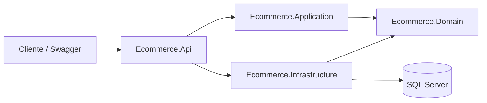

# OrderFlow

API REST para gerenciamento de compradores, produtos e pedidos, com foco em regras de negócio, organização em camadas e confiabilidade da aplicação.

> O projeto nasceu como um desafio técnico e foi evoluído para um case de portfólio voltado a backend e engenharia de software.

## O que este projeto demonstra

- Modelagem de domínio e regras de negócio para ciclo de vida de pedidos
- API REST com ASP.NET Core
- Persistência com Entity Framework Core e SQL Server
- Paginação e filtros
- Tratamento global de exceções
- Health checks e resiliência de conexão
- Testes unitários do domínio
- Ambiente local reproduzível com Docker Compose

## Tecnologias

- .NET 8
- ASP.NET Core Web API
- Entity Framework Core 8
- SQL Server 2022
- Docker Compose
- Swagger / OpenAPI
- xUnit

## Arquitetura



```text
src
├── Ecommerce.Api
├── Ecommerce.Application
├── Ecommerce.Domain
└── Ecommerce.Infrastructure

tests
└── Ecommerce.Domain.Tests
```

### Ecommerce.Api

Endpoints HTTP, configuração da aplicação, Swagger, health check e middleware global de exceções.

### Ecommerce.Application

DTOs, contratos de serviços e exceções da aplicação.

### Ecommerce.Domain

Entidades, enums e regras do domínio.

### Ecommerce.Infrastructure

Entity Framework Core, DbContext, migrations e implementações dos serviços.

## Domínio de pedidos

O pedido percorre um fluxo de estados controlado por regras de negócio:

```text
Iniciado -> Processado -> Enviado
    |           |
    +------> Cancelado
```

Regras implementadas:

- Todo pedido deve possuir um comprador válido.
- Todo pedido deve possuir pelo menos um item.
- Cada item deve possuir quantidade maior que zero.
- Cada item deve referenciar um produto existente.
- Apenas pedidos iniciados podem ser alterados.
- Apenas pedidos iniciados podem ser processados.
- Apenas pedidos processados podem ser enviados.
- Apenas pedidos iniciados ou processados podem ser cancelados.
- Apenas pedidos iniciados podem ser excluídos.

## Recursos da API

### Compradores

| Método | Endpoint |
| --- | --- |
| POST | `/api/v1/compradores` |
| GET | `/api/v1/compradores` |
| GET | `/api/v1/compradores/{id}` |

### Produtos

| Método | Endpoint |
| --- | --- |
| POST | `/api/v1/produtos` |
| GET | `/api/v1/produtos` |
| GET | `/api/v1/produtos/{id}` |

### Pedidos

| Método | Endpoint |
| --- | --- |
| POST | `/api/v1/pedidos` |
| GET | `/api/v1/pedidos` |
| GET | `/api/v1/pedidos/{id}` |
| PUT | `/api/v1/pedidos/{id}` |
| DELETE | `/api/v1/pedidos/{id}` |
| PATCH | `/api/v1/pedidos/{id}/processar` |
| PATCH | `/api/v1/pedidos/{id}/enviar` |
| PATCH | `/api/v1/pedidos/{id}/cancelar` |

### Paginação e filtros

A listagem de pedidos aceita paginação e filtros por status e comprador.

```http
GET /api/v1/pedidos?pagina=1&tamanhoPagina=10&status=Iniciado
```

```http
GET /api/v1/pedidos?pagina=1&tamanhoPagina=10&compradorId={guid}
```

## Tratamento de erros

A aplicação usa middleware global para padronizar falhas da API. Erros inesperados são registrados com método HTTP, caminho da requisição e `TraceId`.

| Situação | Status |
| --- | ---: |
| Entidade não encontrada | 404 |
| Regra de negócio inválida | 400 |
| Erro inesperado | 500 |

## Health Check

```http
GET /health
```

O endpoint verifica a aplicação e a conexão com o SQL Server.

Exemplo:

```json
{
  "status": "Healthy",
  "checks": [
    {
      "name": "sqlserver",
      "status": "Healthy"
    }
  ]
}
```

## Como executar

### 1. Subir o SQL Server

```bash
docker compose up -d
```

As credenciais presentes no Docker Compose são destinadas exclusivamente ao ambiente local de desenvolvimento.

### 2. Restaurar dependências

```bash
dotnet restore Ecommerce.sln
```

### 3. Executar a API

```bash
dotnet run --project src/Ecommerce.Api
```

As migrations são aplicadas automaticamente na inicialização.

### 4. Abrir o Swagger

```text
http://localhost:5115/swagger
```

## Testes

```bash
dotnet test Ecommerce.sln
```

Os testes atuais cobrem regras centrais do domínio, incluindo transições permitidas de status e cálculo do valor total do pedido.

## Decisões técnicas

- `Guid` é utilizado como identificador das entidades.
- Datas são persistidas em UTC.
- O preço unitário é copiado para o item do pedido no momento da criação, preservando o valor histórico da compra.
- Consultas de leitura usam `AsNoTracking()` quando apropriado.
- A conexão com SQL Server usa `EnableRetryOnFailure()` para falhas transitórias.
- E-mail de comprador possui índice único no banco.

## Roadmap

- [ ] Autenticação e autorização com JWT
- [ ] Testes de integração da API e persistência
- [ ] Pipeline de CI com build e testes automatizados
- [ ] Deploy público da API e banco
- [ ] Melhorar separação entre camada de aplicação e infraestrutura
- [ ] Observabilidade estruturada e métricas

## Autor

Desenvolvido por **João Luís Dionízio dos Santos**.
