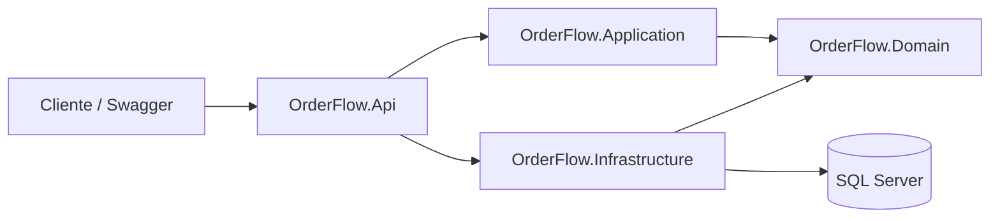

# OrderFlow

API REST corporativa interna para gerenciamento de compradores, produtos e pedidos, com foco em regras de negócio, organização em camadas e confiabilidade da aplicação. Contas representam funcionários. Compradores são entidades de negócio independentes.

> O projeto nasceu como um desafio técnico e foi evoluído para um case de portfólio voltado a backend e engenharia de software.

## O que este projeto demonstra

- Modelagem de domínio e regras de negócio para ciclo de vida de pedidos
- API REST com ASP.NET Core
- Persistência com Entity Framework Core e SQL Server
- Paginação e filtros
- Tratamento global de exceções
- Health checks e resiliência de conexão
- Testes unitários do domínio
- CI com build e testes automatizados
- Ambiente local reproduzível com Docker Compose

## Tecnologias

- .NET 10 LTS (SDK 10.0.404, runtime 10.0.15)
- ASP.NET Core 10 Web API
- Entity Framework Core 10.0.15
- SQL Server 2022
- Docker Compose
- Swagger / OpenAPI
- xUnit
- GitHub Actions

## Arquitetura



```text
src
├── OrderFlow.Api
├── OrderFlow.Application
├── OrderFlow.Domain
└── OrderFlow.Infrastructure

tests
├── OrderFlow.Domain.Tests
└── OrderFlow.Tests
```

### OrderFlow.Api

Endpoints HTTP, configuração da aplicação, Swagger, health check e middleware global de exceções.

### OrderFlow.Application

DTOs, contratos de serviços e exceções da aplicação.

### OrderFlow.Domain

Entidades, enums e regras do domínio.

### OrderFlow.Infrastructure

Entity Framework Core, DbContext, migrations e implementações dos serviços.

## Domínio de pedidos

O pedido percorre um fluxo de estados controlado por regras de negócio:

```text
Iniciado -> Processado -> Enviado
    |           |
    +------> Cancelado
```

Regras implementadas:

- Todo pedido deve possuir um comprador válido.
- Todo pedido deve possuir pelo menos um item.
- Cada item deve possuir quantidade maior que zero.
- Cada item deve referenciar um produto existente.
- Apenas pedidos iniciados podem ser alterados.
- Ao editar um pedido iniciado, a API substitui todos os itens por novos itens com os preços unitários atuais dos produtos, inclusive para produtos que já estavam no pedido.
- Apenas pedidos iniciados podem ser processados.
- Apenas pedidos processados podem ser enviados.
- Apenas pedidos iniciados ou processados podem ser cancelados.
- Apenas pedidos iniciados podem ser excluídos.

## Recursos da API

### Autenticação e perfis

| Ação | Anônimo | Sem perfil | Operator | Admin |
| --- | --- | --- | --- | --- |
| `POST /api/v1/auth/login` com credenciais válidas | Sim | Sim | Sim | Sim |
| `POST /api/v1/auth/registrar` | 401 | 403 | 403 | 204 |
| Operações de compradores, produtos e pedidos | 401 | 403 | Sim | Sim |
| Sondas `GET` ou `HEAD` em `/health`, `/health/live` e `/health/ready` | Sim | Sim | Sim | Sim |

O cadastro recebe `nome`, `email` e `senha`. O servidor provisiona sempre um `Operator` e rejeita campos extras, incluindo `role` e `perfil`. O login retorna o token JWT em `token` e a validade em `expiraEm`. Use `Authorization: Bearer <token>` nas rotas protegidas. No Swagger em desenvolvimento, use **Authorize** para informar o JWT e consulte os perfis exigidos por operação. Tokens ausentes ou inválidos recebem `401` nas rotas protegidas. Um token válido sem o perfil exigido recebe `403`.

A fallback policy do ASP.NET Core aplica a mesma regra de `Operacao` a endpoints sem metadados de autorização. A policy padrão também aplica `Operacao` quando uma rota usa somente `[Authorize]`. As policies explícitas continuam sendo `Operacao` para `Admin` ou `Operator` e `Provisionamento` para `Admin`. A validação JWT existente desconsidera perfis ausentes, desconhecidos ou ambíguos. Contas legadas sem perfil podem fazer login e recebem `403` nas operações protegidas. [Policies de autorização no ASP.NET Core](https://learn.microsoft.com/aspnet/core/security/authorization/policies?view=aspnetcore-10.0)

O login e as três sondas declaram acesso anônimo. Depois das verificações de transporte e cotas, a fallback também é aplicada a requisições sem rota correspondente ou com método incompatível. Elas recebem `401` sem token válido ou `403` sem perfil operacional. Clientes com perfil operacional recebem `404` para rotas inexistentes e `405` para métodos incompatíveis com uma rota existente.

#### Inventário HTTP

| Métodos | Rota | Autorização |
| --- | --- | --- |
| POST | `/api/v1/auth/login` | Anônimo |
| POST | `/api/v1/auth/registrar` | `Provisionamento` |
| GET, POST | `/api/v1/compradores` | `Operacao` |
| GET | `/api/v1/compradores/{id:guid}` | `Operacao` |
| GET, POST | `/api/v1/produtos` | `Operacao` |
| GET | `/api/v1/produtos/{id:guid}` | `Operacao` |
| GET, POST | `/api/v1/pedidos` | `Operacao` |
| GET, PUT, DELETE | `/api/v1/pedidos/{id:guid}` | `Operacao` |
| PATCH | `/api/v1/pedidos/{id:guid}/processar` | `Operacao` |
| PATCH | `/api/v1/pedidos/{id:guid}/enviar` | `Operacao` |
| PATCH | `/api/v1/pedidos/{id:guid}/cancelar` | `Operacao` |
| GET, HEAD | `/health/live`, `/health/ready`, `/health` | Anônimo |
| GET | `/swagger`, `/swagger/index.html` e recursos da interface | Anônimo em `Development` |
| GET | `/swagger/v1/swagger.json` | Anônimo em `Development` |

#### Swagger e OpenAPI

O gerador OpenAPI, o JSON e a Swagger UI são habilitados exclusivamente pelo ambiente `Development`. Em `Staging` e `Production`, esses caminhos seguem o tratamento de rotas inexistentes. O filtro OpenAPI usa a combinação de policies do ASP.NET Core para documentar Bearer, perfis e respostas `401` e `403`, inclusive quando uma ação depende da fallback. O login e as [sondas de saúde](#health-check) aparecem sem exigência de Bearer. A interface continua recebendo os cabeçalhos de segurança descritos em [Cabeçalhos e ordem do pipeline](#cabeçalhos-e-ordem-do-pipeline).

O SwaggerGen 9.0.6 usa o Microsoft.OpenApi 1.6.31 para preservar a API usada pelos filtros. O documento é serializado como OpenAPI 3.0.4. A Swagger UI 11.0.1 tem ciclo de atualização independente do gerador e lê esse JSON. Ao atualizar a interface, confira também os advisories das bibliotecas JavaScript do bundle. [Migração do Swashbuckle para OpenAPI.NET 2](https://github.com/domaindrivendev/Swashbuckle.AspNetCore/blob/master/docs/migrating-to-v10.md)

| Rota | Resposta | Condição |
| --- | --- | --- |
| `POST /api/v1/auth/login` | `200 OK` | Credenciais válidas. |
| Login e cadastro | `400 Bad Request` | Corpo ou campos inválidos, com os detalhes de validação. |
| `POST /api/v1/auth/login` | `401 Unauthorized` | E-mail inexistente, senha incorreta ou hash inválido. O corpo é `{"mensagem":"E-mail ou senha inválidos."}`. |
| `POST /api/v1/auth/registrar` | `204 No Content` | Operador criado por um administrador. |
| `POST /api/v1/auth/registrar` | `409 Conflict` | E-mail normalizado já cadastrado, inclusive quando duas solicitações concorrem. Substitui o `400` anterior para duplicidade. O corpo é `{"mensagem":"Já existe um usuário cadastrado com este e-mail."}`. |

O `401` do login inclui `WWW-Authenticate: OrderFlowLogin`, um desafio de esquema particular da API e não padronizado. O cliente trata o `401` e envia `email` e `senha` válidos no corpo JSON do `POST /api/v1/auth/login`. O Swagger documenta o desafio como cabeçalho de resposta e executa o login com o corpo JSON. Clientes HTTP genéricos podem ignorar esquemas desconhecidos ou falhar ao interpretar o desafio. Integrações devem tratar o status e o corpo, sem depender da autenticação automática do cliente. As respostas de login e cadastro incluem `Cache-Control: no-store`. [RFC 9110, §§ 11.3 e 11.6.1](https://www.rfc-editor.org/rfc/rfc9110.html#section-11.6.1) · [Registro de esquemas HTTP da IANA](https://www.iana.org/assignments/http-authschemes/)

O cadastro remove espaços das extremidades do e-mail e o converte para minúsculas. O SQL Server mantém o bloqueio da chave ou do intervalo em `IX_Usuarios_Email` entre a consulta e a inclusão, dentro da mesma transação. O cadastro retorna `409` quando essa consulta encontra o e-mail. O índice permanece único. O resultado independe do idioma da sessão e falhas SQL seguem o tratamento de erro interno. Isso inclui `2601`, que pode vir de outro índice único, e `2627`, que corresponde a uma restrição como `PRIMARY KEY` ou `UNIQUE`. Uma inclusão que falha desvincula apenas o usuário da tentativa do `ChangeTracker`. [Bloqueios no SQL Server](https://learn.microsoft.com/en-us/sql/relational-databases/sql-server-transaction-locking-and-row-versioning-guide) · [Códigos de erro do SQL Server](https://learn.microsoft.com/en-us/sql/relational-databases/errors-events/database-engine-events-and-errors-2000-to-2999)

Os conflitos de cadastro são registrados por operação e ID de rastreio. A configuração do EF Core omite seis eventos cujas exceções podem conter dados rejeitados em mensagens do servidor. As categorias de log continuam disponíveis. [Logging do EF Core](https://learn.microsoft.com/en-us/ef/core/logging-events-diagnostics/extensions-logging)

### Limites de requisições

Os valores abaixo são defaults iniciais para uma instância da API interna. Os limites de produção exigem testes de carga com a capacidade do host, a latência do SQL Server e o tráfego esperado. A configuração é lida e validada na inicialização. Para sobrescrever um valor, use a seção `RateLimiting` ou uma variável como `RateLimiting__LoginPorOrigem`. As cotas de frequência aceitam de 1 a 100.000 requisições por janela e as de concorrência aceitam de 1 a 1.024 requisições simultâneas.

| Chave em `RateLimiting` | Padrão | Escopo |
| --- | ---: | --- |
| `JanelaSegundos` | 60 | Duração das janelas de frequência. Aceita de 1 a 3.600 segundos. |
| `GlobalPorJanela` | 1.200 | Requisições da API por instância, incluindo tentativas anônimas que passam pela cota de origem quando aplicável. |
| `GlobalConcorrente` | 32 | Requisições da API em andamento por instância. |
| `LoginPorOrigem` | 20 | Tentativas por endereço de origem por janela. |
| `LoginPorIdentificador` | 5 | Tentativas com entrada válida por e-mail normalizado por janela, mesmo para contas inexistentes. |
| `LoginConcorrente` | 4 | Logins em andamento por instância, dentro do limite global. |
| `CadastroPorAdmin` | 10 | Solicitações de cadastro por administrador por janela. |
| `OperacoesPorUsuario` | 120 | Operações autorizadas por usuário e por janela, incluindo rotas protegidas pela fallback. |
| `SaudePorJanela` | 30 | Sondas de readiness por instância e por janela, somadas entre `/health/ready` e `/health`. |
| `SaudeConcorrente` | 1 | Sondas de readiness simultâneas nos dois caminhos somados. |
| `LivenessPorJanela` | 30 | Sondas de `/health/live` por instância e por janela. |
| `LivenessConcorrente` | 1 | Sondas de liveness simultâneas por instância. |
| `MaximoChavesPorJanela` | 1.024 | Máximo de chaves em cada tabela de origens, identificadores de login, administradores e operadores. Aceita até 100.000. |

Os limites de frequência usam janelas fixas com relógio monotônico. Esse modelo admite rajadas próximas à renovação da janela. A concorrência usa o limitador nativo do ASP.NET Core e rejeita o excedente imediatamente. O teto global de 32 restringe o trabalho simultâneo, e o teto de quatro logins limita a pressão das 600 mil iterações de PBKDF2 sobre as outras operações. O orçamento de saúde limita o trabalho do SQL Server sem disputar as cotas da API.

O roteamento identifica login e saúde. A API aplica os limites de concorrência primeiro, seguidos pela cota de login por origem e pela cota de frequência da API, da readiness ou da liveness. Essas verificações ocorrem antes do Bearer, da autorização e do model binding. Um login recusado pela cota de origem preserva o orçamento global. Operações e cadastro só consomem a cota individual após autorização, usando o GUID da claim `sub` validada. O MVC lê o JSON do login uma vez. Após a validação do DTO, a API aplica a cota por identificador antes de consultar o banco ou executar PBKDF2.

A origem vem de `Connection.RemoteIpAddress` após o encaminhamento de [proxies confiáveis](#https-proxies-e-hosts), quando habilitado. IPv4 e sua forma mapeada em IPv6 compartilham a mesma cota. Clientes atrás do mesmo NAT ou proxy também podem compartilhar uma cota. Conexões cujo endereço é desconhecido compartilham uma cota própria.

O identificador de login segue a mesma normalização do serviço de autenticação, removendo espaços das extremidades e convertendo o e-mail para minúsculas. A partição guarda um HMAC-SHA256 calculado com uma chave aleatória independente por processo. Cada tabela guarda até 1.024 chaves por padrão e é limpa na renovação de sua janela. Quando a tabela enche, novas chaves recebem `429` até a renovação e as chaves registradas mantêm suas cotas restantes.

Muitas origens distintas podem preencher a tabela de origens, e tentativas válidas na forma podem preencher a de identificadores ou consumir a cota de um identificador conhecido. Isso pode impedir logins legítimos temporariamente. O tráfego que passa pela cota de origem também pode esgotar a frequência global e afetar outras rotas. Se a cota de saúde se esgotar, sondas legítimas também podem receber `429` até a próxima janela. Para uma API interna, restrinja o acesso às redes autorizadas no firewall ou proxy de entrada existente. Essa medida reduz a exposição sem reiniciar contadores ativos ou ampliar o uso de memória.

Respostas `429 Too Many Requests` incluem `Cache-Control: no-store` e o corpo genérico `{"mensagem":"Muitas requisições. Tente novamente mais tarde."}`. Se uma janela de frequência estiver esgotada, `Retry-After` informa os segundos até sua renovação, arredondados para cima. Rejeições por concorrência omitem o cabeçalho, pois dependem do término de outra chamada. As cotas são locais e reiniciam com o processo. Em múltiplas réplicas, use limites compartilhados no gateway se a política exigir uma cota única.

### Tamanho do corpo e validação de entrada

| Entrada | Limite ou regra |
| --- | --- |
| Corpo de requisição | 256 KiB (262.144 bytes) no Kestrel. |
| Corpo de login | 16 KiB (16.384 bytes) em `POST /api/v1/auth/login`. |
| JSON | Até 32 níveis de profundidade, incluindo a raiz. |
| Nome de usuário, comprador ou produto | Obrigatório, com até 150 unidades UTF-16. |
| E-mail de usuário ou comprador | Obrigatório, com até 200 unidades UTF-16, inclusive no login. O e-mail do comprador também exige um domínio com ponto. |
| Preço de produto | De 0,01 a 9.999.999.999.999.999,99, conforme `decimal(18,2)` no SQL Server. O valor deve ser representável em centavos. Zeros adicionais após os centavos são aceitos. |
| Criação e atualização de pedidos | De 1 a 100 itens. Cada item precisa de um GUID de produto diferente de zero e de uma quantidade inteira de 1 a 2.147.483.647. A criação também exige um GUID de comprador diferente de zero. Produtos repetidos continuam aceitos como linhas distintas. |
| Total de pedido | A API rejeita antes da gravação totais que perderiam centavos ao serem representados pelo tipo `decimal` do contrato de resposta. |
| Listagens de compradores, produtos e pedidos | Página a partir de 1, tamanho de 1 a 50 e deslocamento de até 10.000 registros. |

Preços e subtotais mantêm a precisão em centavos do SQL Server. Os valores monetários das respostas continuam como números JSON. Consumidores que usam ponto flutuante binário, como `Number` em JavaScript, podem perder centavos, especialmente em valores altos. Para cálculos financeiros, leia os dígitos do JSON diretamente com um tipo ou biblioteca decimal. Pedidos legados gravados antes desta validação podem ter totais fora da precisão do contrato de resposta. [RFC 8259, seção 6](https://www.rfc-editor.org/rfc/rfc8259#section-6)

Os tetos de corpo são valores iniciais para desenvolvimento. O login usa menos de 14 KiB mesmo com os 1.024 caracteres Unicode da senha legada codificados como pares de escapes JSON e o e-mail no limite. Os demais contratos usam poucos campos ou até 100 itens, o que deixa margem abaixo de 256 KiB. Espaços sintáticos, escapes, codificação e dados extras contam no limite. Valide o tamanho dos payloads reais e teste carga antes de adotar esses valores em produção. Os tetos do aplicativo são constantes, e os limites de campos e coleções fazem parte do contrato.

A aplicação rejeita um `Content-Length` excessivo antes de acessar os serviços, após as cotas e a autorização aplicáveis. O Kestrel também limita os bytes observados durante a leitura quando o cabeçalho está ausente. Em HTTP/1.1 com `Transfer-Encoding: chunked`, o Kestrel conta parte do enquadramento dos blocos, de modo que o espaço útil para JSON é um pouco menor. Nas rotas sem corpo declarado, a aplicação descarta o corpo de forma incremental antes de executar a ação. Em ações com JSON, o MVC desserializa o corpo uma vez. Em caso de erro `400` ou `415` sem tamanho declarado, a aplicação descarta o restante da mesma leitura sob o limite do Kestrel. Autorizações ou cotas podem rejeitar a requisição antes da leitura. Um proxy pode aplicar seu próprio teto ou formato de erro antes que a requisição chegue à aplicação. Configure o proxy e o servidor de hospedagem de acordo com o contrato do ambiente. [Limites do Kestrel](https://learn.microsoft.com/aspnet/core/fundamentals/servers/kestrel/options)

Login e cadastro rejeitam propriedades JSON desconhecidas, inclusive tentativas de enviar o perfil no cadastro. Clientes de login que enviavam campos extras agora recebem `400` e devem enviar apenas `email` e `senha`. Os DTOs operacionais continuam aceitando propriedades adicionais. A configuração web do `System.Text.Json` compara os nomes das propriedades conhecidas sem distinguir maiúsculas de minúsculas. Quando a desserialização termina com sucesso, o valor da última ocorrência é o que passa pela validação e chega à cota por identificador e à autenticação. O login mede o e-mail recebido antes da normalização compartilhada entre autenticação e limitador. A senha mantém a política Unicode, os espaços e os limites descritos na seção de senhas. [Membros desconhecidos no System.Text.Json](https://learn.microsoft.com/dotnet/standard/serialization/system-text-json/missing-members)

Pedidos com coleções estruturalmente inválidas são rejeitados antes de consultar o banco. O teto de itens também limita o número de consultas individuais de produto. Os resultados da análise de custo da paginação estão em [Comportamento no SQL Server](#comportamento-no-sql-server).

### Segurança dos tokens JWT

| Configuração | Requisito |
| --- | --- |
| `Jwt__Issuer` | Emissor obrigatório, com valor não vazio. `appsettings.json` fornece `Ecommerce.Api`. |
| `Jwt__Audience` | Público obrigatório, com valor não vazio. `appsettings.json` fornece `Ecommerce.Api`. |
| `Jwt__Chave` | Chave de assinatura obrigatória, com pelo menos 32 bytes em UTF-8. Forneça pelo ambiente ou por um gerenciador de segredos. |
| `Jwt__ExpiraMinutos` | Inteiro de 1 a 60. O padrão de 60 minutos só vale se a configuração estiver ausente. Um valor vazio é inválido. |

A API valida essas configurações antes das migrations. Aceita exclusivamente `HS256` com assinatura válida. Compara `iss` e `aud` por igualdade ordinal, incluindo capitalização e barras finais. O público deve ser um único valor, como string ou array de um elemento. `exp` é obrigatório e indica o instante a partir do qual o token expira. Quando presente, `nbf` indica o primeiro instante de validade. Ambos usam segundos inteiros desde a época Unix, com tolerância de relógio zero. Falhas de autenticação em rotas protegidas recebem `401`, `WWW-Authenticate: Bearer` e corpo vazio. [RFC 7519](https://www.rfc-editor.org/rfc/rfc7519.html#section-4.1) · [Opções do JWT Bearer no ASP.NET Core](https://learn.microsoft.com/en-us/dotnet/api/microsoft.aspnetcore.authentication.jwtbearer.jwtbeareroptions?view=aspnetcore-10.0)

O `sub` deve ser uma única string com o GUID persistido do funcionário no formato `D`, diferente de `Guid.Empty`. Claims de identidade ambíguas recebem `401`. A API mantém os nomes originais das claims, com `sub` como identidade e `role` como perfil. `Operacao` exige uma única claim `role` escalar com `Admin` ou `Operator`. `Provisionamento` exige uma única claim `role` escalar com `Admin`. Perfil ausente, múltiplo, desconhecido ou apresentado por alias resulta em `403` nas rotas com essas policies quando o token é válido. Os novos tokens incluem `sub`, `iss`, `aud`, `exp` e, quando aplicável, `role`. Nome e e-mail ficam fora das novas emissões. Tokens anteriores emitidos pela API com essas claims continuam válidos enquanto atendem às regras de validação. Swagger e os fluxos HTTP do repositório usam o token como valor opaco. Integrações que decodificam o JWT precisam usar `sub` para identificar a conta.

`Jwt__ExpiraMinutos` limita a duração na emissão a 60 minutos. Na validação, a API verifica o `exp` assinado, sem recalcular a duração original nem aplicar retroativamente o limite de emissão. Tokens legados com uma duração maior podem permanecer válidos até seu próprio `exp`.

O perfil é registrado no token no momento do login. Após uma mudança no banco, o próximo login reflete o novo perfil. Um token já emitido mantém as permissões anteriores até expirar ou até a troca da chave de assinatura. Um token copiado também pode ser reutilizado nesse intervalo. A API atual não tem revogação individual nem consulta o perfil no banco a cada requisição.

Para rotacionar a chave, gere um segredo independente e coordene a troca em todas as instâncias, retirando de serviço as que usam a chave anterior antes de liberar tráfego para as atualizadas. Cada instância carrega uma única chave na inicialização. Após a troca, tokens assinados com a chave anterior recebem `401` e os funcionários precisam fazer login novamente. [RFC 8725](https://www.rfc-editor.org/rfc/rfc8725.html#section-3.5)

### Segurança das senhas

O cadastro de operadores e o provisionamento de administradores usam a mesma política. Novas senhas têm de 15 a 128 pontos de código Unicode e aceitam espaços e frases-senha, sem exigir combinações de tipos de caracteres. Um caractere suplementar conta como um ponto de código. Uma letra e um acento combinante separado contam como dois. Sequências Unicode inválidas são recusadas. A verificação e o hashing usam a senha inteira, incluindo espaços iniciais e finais, sem truncamento nem normalização Unicode. [NIST SP 800-63B-4](https://pages.nist.gov/800-63-4/sp800-63b.html#passwordver)

O bloqueio local compara a senha inteira, ignorando maiúsculas e minúsculas nessa comparação. Ele cobre uma lista curta de frases previsíveis e alguns padrões de teclado e repetição. A cobertura é parcial e não detecta senhas comprometidas fora da lista e dos padrões.

O login aceita senhas legadas abaixo de 15 e acima de 128 caracteres, até o teto de 1.024 pontos de código. O fluxo anterior não tinha teto de comprimento e o hash armazenado não revela o comprimento original. Por isso, senhas legadas acima de 1.024 caracteres passam a ser recusadas e exigem tratamento administrativo antes de o usuário voltar a acessar a conta.

O armazenamento continua no formato `iteracoes.salt.hash`, com PBKDF2-HMAC-SHA256, salt aleatório de 16 bytes e saída de 32 bytes. Novos hashes usam 600.000 iterações. A verificação aceita de 100.000 a 1.200.000 iterações e valida a estrutura, o Base64 e os tamanhos antes da derivação. A comparação dos bytes usa `FixedTimeEquals`. Registros inválidos resultam na mesma falha de autenticação de uma senha incorreta e geram um aviso sem identificadores de usuário, senhas ou hashes. [OWASP Password Storage Cheat Sheet](https://cheatsheetseries.owasp.org/cheatsheets/Password_Storage_Cheat_Sheet.html#pbkdf2)

O login executa uma verificação com um hash de referência pré-calculado de 600.000 iterações quando a conta está ausente ou o registro está inválido. O resultado dessa verificação é descartado. Uma senha incorreta em um hash legado executa uma segunda derivação com as iterações faltantes para atingir 600.000. A segunda chamada tem custo fixo de inicialização adicional. Essa mitigação reduz diferenças de tempo. Custos armazenados acima de 600.000 iterações, acesso ao banco e execução do processo ainda podem produzir sinais de enumeração.

Após um login correto, hashes abaixo de 600.000 iterações são atualizados com um salt novo. A atualização modifica apenas `SenhaHash` e só grava se o hash anterior ainda corresponder exatamente ao lido. Quando outra operação vence a disputa, o login verifica a senha novamente com o registro atual. Hashes válidos com custo superior são preservados. A atualização dispensa migration e ocorre à medida que os usuários autenticam.

#### Medição local do PBKDF2

Medição em Release no macOS 27.2.1, Apple M4 (Arm64), .NET 8.0.27 (SDK 8.0.421). Um processo nativo executou 20 amostras sequenciais por custo, em ordem alternada e após três aquecimentos por custo. A medição incluiu apenas a chamada `Rfc2898DeriveBytes.Pbkdf2`, com entrada sintética ASCII de 32 bytes, salt de 16 bytes e saída de 32 bytes.

| Iterações | Mediana | p95 |
| --- | --- | --- |
| 100.000 | 13,85 ms | 14,19 ms |
| 600.000 | 83,39 ms | 84,93 ms |

O custo mediano da derivação foi 6,02 vezes maior. O primeiro login que atualiza um hash de 100.000 iterações executa as duas derivações. Os números não incluem HTTP, banco ou concorrência e não são usados como limites de latência no CI.

### Compradores

| Método | Endpoint |
| --- | --- |
| POST | `/api/v1/compradores` |
| GET | `/api/v1/compradores` |
| GET | `/api/v1/compradores/{id}` |

### Produtos

| Método | Endpoint |
| --- | --- |
| POST | `/api/v1/produtos` |
| GET | `/api/v1/produtos` |
| GET | `/api/v1/produtos/{id}` |

### Pedidos

| Método | Endpoint |
| --- | --- |
| POST | `/api/v1/pedidos` |
| GET | `/api/v1/pedidos` |
| GET | `/api/v1/pedidos/{id}` |
| PUT | `/api/v1/pedidos/{id}` |
| DELETE | `/api/v1/pedidos/{id}` |
| PATCH | `/api/v1/pedidos/{id}/processar` |
| PATCH | `/api/v1/pedidos/{id}/enviar` |
| PATCH | `/api/v1/pedidos/{id}/cancelar` |

### Paginação e filtros

| Listagem | `tamanhoPagina` padrão | Ordenação |
| --- | ---: | --- |
| `GET /api/v1/compradores` | 20 | `Nome` crescente, depois `Id` crescente |
| `GET /api/v1/produtos` | 20 | `Nome` crescente, depois `Id` crescente |
| `GET /api/v1/pedidos` | 10 | `DataCriacao` decrescente, depois `Id` crescente |

`pagina` começa em 1 e o default também é 1. Os catálogos usam 20 para entregar uma página inicial moderada. Pedidos mantêm 10 para preservar a quantidade padrão de resposta, que inclui os itens de cada pedido. O teto de 50 limita os registros principais por resposta e `(pagina - 1) × tamanhoPagina` pode ser de até 10.000 para limitar o trabalho com páginas profundas. Por exemplo, com tamanho 50, a última página permitida é 201. Com tamanho 1, é 10.001.

Os filtros opcionais de pedidos `status` e `compradorId` podem ser combinados e afetam tanto a contagem como os itens retornados. Cada requisição usa `Authorization: Bearer <token>` com perfil Admin ou Operator.

```http
GET /api/v1/compradores?pagina=2&tamanhoPagina=20
GET /api/v1/produtos?pagina=3&tamanhoPagina=20
GET /api/v1/pedidos?pagina=1&tamanhoPagina=10&status=Iniciado&compradorId=00000000-0000-0000-0000-000000000002
```

Compradores e produtos agora retornam um objeto paginado em HTTP 200. Clientes que consumiam um array na raiz precisam ler `items` e solicitar as demais páginas dentro do limite de deslocamento. Pedidos mantêm os mesmos campos do objeto paginado. `totalItens` e `totalPaginas` são inteiros de 64 bits no OpenAPI. Clientes gerados que usam `int32` nesses campos devem atualizar seus modelos.

Exemplo de resposta para a terceira página de produtos com 41 registros no total.

```json
{
  "items": [
    {
      "id": "00000000-0000-0000-0000-000000000041",
      "nome": "Teclado",
      "preco": 199.90,
      "dataCriacao": "2026-06-02T15:00:00"
    }
  ],
  "paginaAtual": 3,
  "tamanhoPagina": 20,
  "totalItens": 41,
  "totalPaginas": 3
}
```

Uma página válida além da última retorna HTTP 200 com `items: []` e os totais da consulta. Se nenhum registro corresponder à consulta, ambos os totais são zero.

```json
{
  "items": [],
  "paginaAtual": 1,
  "tamanhoPagina": 10,
  "totalItens": 0,
  "totalPaginas": 0
}
```

Envie os parâmetros de paginação e os filtros diretamente na query string, sem prefixo. Parâmetros fora dos limites retornam HTTP 400 antes da consulta ao banco. Por exemplo, `GET /api/v1/pedidos?pagina=202&tamanhoPagina=50` retorna o erro abaixo. Valores vazios, não numéricos ou fora do intervalo de `int32` recebem HTTP 400 com `application/problem+json`. Clientes que dependiam do ajuste automático de página ou tamanho em pedidos precisam enviar valores válidos. As respostas 401, 403 e 429 seguem as regras de autenticação, autorização e cotas.

```json
{"mensagem":"O deslocamento da página deve ser de no máximo 10000 registros."}
```

#### Comportamento no SQL Server

As listagens executam uma contagem exata com `COUNT_BIG(*)` e uma consulta de dados com `ORDER BY … OFFSET … FETCH NEXT`. Compradores e produtos projetam as colunas dos DTOs. Pedidos contam apenas as linhas da tabela principal com os filtros e paginam os pedidos antes de juntar a coleção de itens. O preço unitário histórico e o cálculo em `decimal` no domínio continuam sendo usados para subtotal e total.

Inserções ou exclusões concorrentes podem deslocar registros entre páginas e fazer a contagem divergir dos dados retornados na mesma chamada. O desempate por `Id` estabiliza a ordem para um conjunto de dados fixo. O total descreve todo o conjunto filtrado, que pode conter mais páginas do que o limite de deslocamento permite solicitar.

O teto da página de pedidos se aplica aos pedidos principais. A resposta inclui todos os itens de cada pedido, inclusive de pedidos legados com mais de 100. Esses pedidos podem ampliar o volume lido, a memória usada e o tamanho da resposta. Totais legados continuam sujeitos à precisão e ao intervalo de `decimal`.

Os índices atuais incluem as chaves primárias, o e-mail do comprador e as FKs `Pedidos.CompradorId`, `ItensPedido.PedidoId` e `ItensPedido.ProdutoId`. O experimento usou SQL Server 2022 Developer `16.0.4260.1` (compatibilidade 160), em contêiner `linux/amd64` no Docker Desktop em ARM64, com o esquema das migrations existentes. Foram geradas 30.000 linhas por tabela principal e 120.000 itens, quatro por pedido. Os pedidos foram distribuídos entre 101 compradores e quatro status. As estatísticas das quatro tabelas foram atualizadas com `FULLSCAN`.

Para cada cenário, o serviço executou as consultas com EF Core 8.0.21. Os comandos capturados foram reexecutados com os mesmos parâmetros, `SET STATISTICS IO ON` e plano real (`SET STATISTICS XML ON`). As medições abaixo somam as leituras lógicas de todas as tabelas de cada comando. Os comandos medidos tiveram zero leituras físicas.

| Cenário | Página × tamanho | `COUNT_BIG` | Consulta de dados |
| --- | ---: | ---: | ---: |
| Compradores | 201 × 50 | 286 | 430 |
| Produtos | 201 × 50 | 308 | 308 |
| Pedidos sem filtro | 201 × 50 | 196 | 1.597 |
| Pedidos com `status=Iniciado` | 2 × 20 | 283 | 803 |
| Pedidos do comprador 42 na massa sintética | 2 × 20 | 5 | 746 |
| Pedidos do comprador 42 com `status=Iniciado` | 2 × 20 | 283 | 748 |

A contagem por comprador buscou por `IX_Pedidos_CompradorId`. A contagem por status e a contagem com os dois filtros varreram a chave primária de pedidos. Os planos das consultas paginadas fizeram varredura e ordenação e buscaram os itens de pedidos por `IX_ItensPedido_PedidoId`. O teto de deslocamento limita quantos registros a página pode pular. A contagem e a ordenação ainda podem ler todo o conjunto.

Leituras lógicas contam acessos a páginas de dados em memória. O tempo de execução do SQL e a latência HTTP percebida pelo cliente exigem medições próprias, incluindo, no caso da API, materialização, serialização e rede. O experimento mediu leituras e planos para os parâmetros acima. Uma comparação de desempenho exige consultas equivalentes e uma linha de base medida nas mesmas condições.

Na fase 02, meça planos, leituras e latência com volume, distribuição e frequência de filtros representativos. Compare os benefícios de índices compostos para as ordenações e filtros mais usados com o custo adicional de escrita e armazenamento. Avalie também paginação por cursor para navegação profunda, custos de contagens exatas, um resumo de pedidos com consulta separada dos itens e busca em lote de produtos ao gravar pedidos.

## Tratamento de erros

O middleware preserva os status e mensagens públicas de regras de negócio, entidade ausente, login inválido e conflito de cadastro. Para falhas inesperadas, retorna `500` com `Cache-Control: no-store` e, em requisições diferentes de `HEAD`, o corpo `{"mensagem":"Ocorreu um erro interno no servidor."}`. Os logs registram a ação ou o modelo de rota, os tipos da falha e da causa, o código SQL quando disponível e o `TraceId` da requisição. A API limita os logs de hospedagem, roteamento, encaminhamento e invocação de ações para evitar o registro de URLs e argumentos. Também silencia os logs de comandos SQL, do formatador JSON e das categorias do Bearer e de requisições rejeitadas pelo Kestrel que podem carregar exceções ou dados do protocolo.

Se os cabeçalhos já tiverem sido enviados, o middleware registra os mesmos metadados e aborta a conexão. Quando o cliente desconecta, o cancelamento associado a `RequestAborted` e as exceções de conexão encerrada terminam sem novo corpo e sem log de erro interno. Cancelamentos internos são registrados como falhas e retornam `500` se a conexão estiver ativa. O MVC mantém `400 application/problem+json` com mensagens de validação e `traceId`. Erros de conversão de JSON são genéricos e usam a chave `$` quando o caminho puder conter dados enviados pelo cliente. As falhas de startup e os logs gerados diretamente pelo host ou proxy ficam fora desse middleware.

| Situação | Status |
| --- | ---: |
| Dados inválidos ou JSON malformado | 400 |
| Regra de negócio inválida | 400 |
| Credenciais de login inválidas ou token ausente ou inválido em rota protegida | 401 |
| Token válido sem o perfil exigido | 403 |
| Entidade não encontrada | 404 |
| E-mail de usuário já cadastrado | 409 |
| Corpo acima do limite | 413 |
| Formato de conteúdo não suportado em uma ação que lê o corpo | 415 |
| Limite de frequência ou concorrência atingido | 429 |
| Erro inesperado | 500 |

## Health Check

| Rota | O que verifica | HTTP 200 | HTTP 503 |
| --- | --- | --- | --- |
| `/health/live` | O processo atende HTTP, sem acesso ao SQL Server. | `Healthy` | — |
| `/health/ready` | As dependências essenciais, incluindo uma consulta simples ao SQL Server usado pela aplicação, com cancelamento após três segundos. | `Healthy` | `Unhealthy` ou `Degraded`. |
| `/health` | Alias de compatibilidade de `/health/ready`. | `Healthy` | `Unhealthy` ou `Degraded`. |

Os três caminhos aceitam `GET`, que retorna apenas o estado agregado em JSON, por exemplo `{"status":"Healthy"}`, e `HEAD`, que retorna o status HTTP sem corpo. Todos desabilitam cache. A propriedade `checks` do contrato anterior de `/health` foi removida. Em readiness, `Degraded` também retorna `503` porque esse grupo contém apenas dependências essenciais. A resposta indica a condição da instância para receber tráfego. Os logs da sonda SQL registram o tipo da falha, o código SQL e a indicação de timeout, sem a exceção ou a conexão.

Envie `GET` e `HEAD` sem corpo, inclusive com `Content-Length: 0`. Depois das verificações de transporte e cotas, a API retorna `400` sem corpo e com `Cache-Control: no-store` se a requisição declarar um corpo, usar transferência em blocos ou deixar o stream aberto sem comprimento declarado em HTTP/2 ou HTTP/3. Um tamanho declarado acima do teto de 256 KiB recebe `413`. A rejeição ocorre antes de acessar o SQL Server e independe do envio do corpo, inclusive com `Expect: 100-continue`.

A vaga de concorrência da aplicação é liberada ao retornar da rejeição. Em HTTP/1.x, a API indica `Connection: close` para evitar a reutilização da conexão com bytes da requisição pendentes. Em HTTP/2 e HTTP/3, o Kestrel gerencia o encerramento do stream. Framing, descarte de bytes, encerramento do transporte e limites de leitura continuam sob responsabilidade do Kestrel e dos proxies. O ingresso pode rejeitar o tráfego antes da aplicação e deve impor seus próprios limites de corpo, tempo e conexões.

Readiness e seu alias compartilham a cota de frequência e concorrência já existente. Liveness tem uma cota própria para continuar disponível quando readiness está saturada ou aguardando o banco. As duas cotas são independentes das operações de usuários. Sondas acima do limite recebem `429`. A sonda SQL usa cancelamento de três segundos para a abertura e a consulta, limita também o timeout de conexão do driver e desativa a recuperação automática de conexão da sonda. A indisponibilidade do processo é detectada por falha de conexão ou timeout. A consulta de readiness confirma conectividade e execução de SQL, com cobertura limitada das permissões, do esquema e da capacidade do banco. As migrations continuam no startup, portanto uma dependência indisponível nessa fase pode impedir a aplicação de abrir a porta.

Fora de `Development`, configure as sondas com HTTPS e um `Host` permitido. Restrinja o acesso a esses caminhos às redes autorizadas de monitoramento no firewall, balanceador ou proxy de entrada, incluindo acesso direto ao backend. Acesso anônimo facilita a operação das sondas, e o host permitido e as cotas por instância ainda deixam margem para saturação por clientes com acesso de rede. Cabeçalhos enviados pelo cliente, inclusive os de encaminhamento, não comprovam origem autorizada.

## Como executar

Instale o SDK .NET 10.0.404 fixado em `global.json`, o Docker com Compose v2 ou superior e o OpenSSL. No macOS com Apple Silicon, use a distribuição Arm64 do SDK. Execute os comandos abaixo na raiz do repositório, em Bash ou Zsh. `dotnet --version` deve mostrar `10.0.404`. [Download oficial do .NET 10](https://dotnet.microsoft.com/en-us/download/dotnet/10.0)

Instale o SDK em um diretório persistente, como `~/.dotnet` ou o destino do instalador oficial. Com uma instalação no diretório do usuário, inclua o diretório no `PATH` da sessão de login e confira se a IDE usa o mesmo executável exibido por `command -v dotnet`. O SDK contém as ferramentas de compilação. O `net10.0` dos projetos define a plataforma-alvo da aplicação e dos testes.

Quando sair um patch de segurança do .NET 10, instale o novo SDK lado a lado, confira o checksum publicado pela Microsoft e atualize a versão exata em `global.json`, mantendo `rollForward: disable`. Revise os patches dos pacotes ASP.NET Core, do EF Core e do `dotnet-ef` no mesmo incremento e atualize as versões documentadas. Repita a auditoria transitiva, o build Release e os testes com SQL Server descartável. O CI lê a versão do SDK de `global.json`. [Política de suporte do .NET](https://dotnet.microsoft.com/en-us/platform/support/policy/dotnet-core)

O SqlClient 6.1.8 fixa o patch da série usada pelo provedor do EF Core, cujo mínimo é 6.1.7. A referência de OpenID Connect mantém toda a família IdentityModel em 8.19.2, inclusive na infraestrutura, que recebe uma versão anterior pelo SqlClient. Essa é a mesma versão usada pelo JWT Bearer 10.0.15. [Release do SqlClient 6.1.8](https://github.com/dotnet/SqlClient/releases/tag/v6.1.8) · [Namespaces e pacotes do IdentityModel](https://github.com/AzureAD/azure-activedirectory-identitymodel-extensions-for-dotnet/wiki)

### 1. Configurar e subir o SQL Server

Para um banco local novo, gere uma senha exclusiva e grave-a em um `.env` com permissões restritas. O comando protege um `.env` que já exista. O [`.env.example`](.env.example) descreve a variável esperada.

```bash
(
  set -eC
  umask 077
  sql_password="$(openssl rand -hex 24)"
  printf 'MSSQL_SA_PASSWORD=Aa1-%s\n' "$sql_password" > .env
)
```

Para usar uma senha própria, preencha `MSSQL_SA_PASSWORD` no `.env`. Para usar os comandos abaixo, mantenha o formato `VAR=valor` em uma única linha, sem aspas nem comentários na mesma linha. Use uma senha longa com maiúsculas, minúsculas, dígitos e hífens. Em uma instalação com dados existentes, siga a seção de rotação de credenciais antes de trocar a senha no arquivo.

O Compose lê o `.env` da raiz para preencher a variável do contêiner. Uma variável homônima exportada no terminal tem precedência. Os comandos abaixo usam o valor do arquivo e validam a configuração sem imprimir a senha. [Interpolação no Docker Compose](https://docs.docker.com/compose/how-tos/environment-variables/variable-interpolation/)

```bash
unset MSSQL_SA_PASSWORD
docker compose config --quiet
docker compose up -d sqlserver
docker compose ps sqlserver
```

O banco fica acessível no host em `127.0.0.1:1433` e persiste os dados no volume `sqlserver_data`. Aguarde a mensagem de que o SQL Server está pronto para conexões antes de iniciar a API.

```bash
docker compose logs --tail=50 sqlserver
```

#### macOS com Apple Silicon

O Compose mantém `platform: linux/amd64` para a imagem do SQL Server 2022. No Docker Desktop, a opção **Use Rosetta for x86_64/amd64 emulation on Apple Silicon** está disponível com o **Apple Virtualization framework**. A Microsoft oferece suporte aos contêineres do SQL Server em Linux x86-64 e não oferece suporte à execução por emulação. Se o banco local falhar sob emulação, execute a API normalmente no Mac e configure `ConnectionStrings__DefaultConnection` com o endereço e a credencial de um SQL Server em Linux x86-64. Em um servidor remoto, use um certificado confiável e mantenha a validação habilitada. [Configurações do Docker Desktop](https://docs.docker.com/desktop/settings-and-maintenance/settings/) · [Plataformas suportadas pelo SQL Server](https://learn.microsoft.com/en-us/sql/linux/install-upgrade/setup?view=sql-server-ver16)

### 2. Restaurar dependências e executar a API no host

`dotnet run` não carrega o `.env` automaticamente. O ASP.NET Core lê `ConnectionStrings__DefaultConnection` do ambiente do processo e usa a mesma string para o EF Core e o health check. `Jwt__Chave` fornece a chave de assinatura. O exemplo usa o emissor e o público de `appsettings.json` e o padrão de 60 minutos na ausência de `Jwt__ExpiraMinutos`. [Configuração do ASP.NET Core](https://learn.microsoft.com/en-us/aspnet/core/fundamentals/configuration/?view=aspnetcore-10.0)

```bash
dotnet restore OrderFlow.sln
dotnet tool restore
dotnet dev-certs https --trust
(
  set -e
  sql_password="$(sed -n 's/^MSSQL_SA_PASSWORD=//p' .env)"
  if [ -z "$sql_password" ]; then
    printf '%s\n' 'Preencha MSSQL_SA_PASSWORD no .env.' >&2
    exit 1
  fi
  Jwt__Chave="${Jwt__Chave:-$(openssl rand -hex 32)}"
  export Jwt__Chave
  export ConnectionStrings__DefaultConnection="Server=127.0.0.1,1433;Database=EcommerceDb;User ID=sa;Password=${sql_password};Encrypt=True;TrustServerCertificate=True"
  dotnet run --project src/OrderFlow.Api --launch-profile https
)
```

O exemplo usa `sa` e `TrustServerCertificate=True` para o contêiner local com certificado autossinado. Fora desse ambiente, forneça as duas variáveis pelo gerenciador de segredos, use um login apropriado para a API e configure a validação do certificado.

Para HS256, gere a chave a partir de pelo menos 32 bytes de aleatoriedade criptográfica, como faz `openssl rand -hex 32` no exemplo. A API mede o comprimento da chave em bytes UTF-8. Caracteres multibyte ocupam mais de um byte, e o comprimento por si só não indica a entropia da chave. Emissão e validação usam a mesma chave carregada no startup. A chave gerada pelo exemplo muda a cada execução se nenhuma chave for fornecida, o que invalida os tokens anteriores. Para manter os tokens entre reinícios, forneça a mesma chave de desenvolvimento por um gerenciador de segredos. [Requisitos do HS256](https://datatracker.ietf.org/doc/html/rfc7518#section-3.2) · [Entropia da chave](https://datatracker.ietf.org/doc/html/rfc8725#section-3.5)

Ao conectar a API a outro SQL Server, forneça a string completa e a chave JWT no ambiente. Antes das migrations, a API verifica a sintaxe da conexão, exige um servidor em `Data Source` ou `Server` e valida as configurações JWT. As mensagens indicam a configuração a corrigir sem incluir seu conteúdo.

A solução `OrderFlow.sln` mantém o nome histórico `EcommerceDb` no exemplo de conexão para continuar usando o banco local existente. Os valores padrão `Ecommerce.Api` de emissor e público mantêm a compatibilidade com os tokens emitidos com essa configuração. O OpenAPI mantém `Ecommerce.Api` como título e como tag das sondas de saúde para preservar a descrição usada por clientes e geradores de código.

A eventual atualização do título público no Swagger fica para uma decisão futura, após avaliar o impacto sobre consumidores e geradores de código.

#### Migrations com a ferramenta local

`dotnet tool restore` instala o `dotnet-ef` 10.0.15 do manifesto do repositório. Para inspecionar as migrations sem conectar ao banco, forneça `ConnectionStrings__DefaultConnection` e `Jwt__Chave` válidas no ambiente do terminal, conforme o exemplo acima. Os comandos usam a API para carregar a configuração de desenvolvimento.

```bash
dotnet ef dbcontext list --project src/OrderFlow.Infrastructure --startup-project src/OrderFlow.Api -- --environment Development
dotnet ef migrations list --no-connect --project src/OrderFlow.Infrastructure --startup-project src/OrderFlow.Api -- --environment Development
dotnet ef migrations has-pending-model-changes --project src/OrderFlow.Infrastructure --startup-project src/OrderFlow.Api -- --environment Development
```

O startup da API aplica as migrations existentes. Para aplicá-las pela CLI em um SQL Server descartável, configure a conexão para esse servidor e confirme o banco de destino antes de executar o comando abaixo. Desde o EF Core 9, a aplicação de migrations falha se o modelo tiver diferenças em relação ao snapshot. [Ferramentas do EF Core](https://learn.microsoft.com/en-us/ef/core/cli/dotnet) · [Mudanças no EF Core 9](https://learn.microsoft.com/en-us/ef/core/what-is-new/ef-core-9.0/breaking-changes)

```bash
dotnet ef database update --project src/OrderFlow.Infrastructure --startup-project src/OrderFlow.Api -- --environment Development
```

### 3. Verificar a aplicação

Com o perfil `https`, abra o Swagger em <https://localhost:7018/swagger>. Em outro terminal, consulte o health check.

```bash
curl --fail --show-error https://localhost:7018/health
```

### HTTPS, proxies e hosts

Em `Development`, o perfil `https` escuta em `https://localhost:7018` e `http://localhost:5115`. Quando há uma porta HTTPS configurada ou detectada, o ASP.NET Core retorna `307` com `Cache-Control: no-store` para requisições HTTP. O perfil `http` mantém `http://localhost:5115` para verificações locais, como `GET /health`, sem redirecionamento quando só há um listener HTTP. Use o perfil `https` para login e requisições com tokens. Um redirecionamento pode preservar o método e o corpo, mas credenciais já enviadas por HTTP foram transmitidas sem TLS. O certificado de desenvolvimento fica restrito ao ambiente local. [HTTPS no ASP.NET Core](https://learn.microsoft.com/aspnet/core/security/enforcing-ssl?view=aspnetcore-10.0)

Fora de `Development`, a API exige HTTPS e devolve `400` com corpo vazio e `Cache-Control: no-store` a requisições HTTP que chegam à aplicação. A aplicação rejeita a requisição antes de ler o corpo, validar o token ou debitar cotas. Credenciais que já chegaram por HTTP trafegaram em claro mesmo quando a API devolve `400`. Clientes e sondas devem acessar uma URL HTTPS desde a primeira requisição. Configure HTTPS no ponto de entrada e desabilite o listener HTTP externo ou rejeite HTTP no gateway.

| Topologia | Configuração |
| --- | --- |
| Acesso direto ao Kestrel | Configure apenas o listener HTTPS do Kestrel e forneça um certificado confiável para o host pelo ambiente de implantação. Use `Kestrel__Endpoints__Https__Url` e `Kestrel__Endpoints__Https__Certificate__Path` para configurar um certificado montado. Forneça `Kestrel__Endpoints__Https__Certificate__Password` pelo gerenciador de segredos quando o arquivo exigir senha. Mantenha certificados de desenvolvimento fora do ambiente de produção e o encaminhamento desabilitado. |
| Terminação TLS no gateway | O gateway recebe HTTPS, preserva o `Host` autorizado e sobrescreve `X-Forwarded-For` com o IP do cliente e `X-Forwarded-Proto` com o esquema que observou. Restrinja o listener do Kestrel aos proxies confiáveis por firewall ou rede privada. Use TLS também entre o gateway e o Kestrel quando a rede intermediária não oferecer proteção suficiente para tokens e corpos de requisição. |

Passe `AllowedHosts` como configuração externa em `Production` e nos demais ambientes fora de `Development`. Use nomes ou IPs exatos separados por ponto e vírgula, sem portas, esquemas ou curingas. Escreva IPv6 entre colchetes e use a mesma representação textual enviada no `Host`. O filtro nativo compara o host sem distinguir maiúsculas e minúsculas e ignora a porta da requisição. Em `Development`, a lista padrão permite `localhost`, `127.0.0.1` e `[::1]`. A API encerra no startup se a lista estiver ausente ou inválida. Hosts ausentes ou não autorizados recebem `400` com corpo vazio. Cadastre no backend o `Host` que o gateway envia. O filtro verifica o destino HTTP e a autorização continua baseada no JWT e nas políticas de acesso. [Filtragem de hosts no Kestrel](https://learn.microsoft.com/aspnet/core/fundamentals/servers/kestrel/host-filtering?view=aspnetcore-10.0)

Exemplo de variáveis externas. Substitua os valores de documentação pelo host autorizado e pelo endereço de conexão do gateway visto pelo Kestrel. Os exemplos de IP e CIDR são alternativas e podem ser combinados se ambos corresponderem a proxies autorizados.

```dotenv
AllowedHosts=orderflow.example.test
TrustedProxies__Enabled=true
TrustedProxies__Addresses__0=192.0.2.10
TrustedProxies__Networks__0=2001:db8:1::/64
```

`TrustedProxies` fica desabilitado por padrão. Ao habilitá-lo, forneça pelo menos um IP específico ou uma rede CIDR dedicada aos proxies. A aplicação valida a lista no startup e rejeita prefixos zero e redes IPv6 que abranjam todo o espaço IPv4 mapeado. IPv4, IPv6 e IPv4 mapeado em IPv6 são aceitos. As redes configuradas são cumulativas. Uma rede abrangente só é apropriada se todo o intervalo estiver reservado a proxies administrados e isolado de clientes e outras cargas. Prefira IPs individuais se o segmento for compartilhado.

O middleware nativo verifica o IP da conexão e consome no máximo um salto. A API só considera um par com um valor em cada cabeçalho, `X-Forwarded-For` com o endereço e `X-Forwarded-Proto` com `http` ou `https`. Pares incompletos, malformados ou com múltiplos valores são ignorados. O gateway deve sobrescrever os cabeçalhos do cliente. `X-Forwarded-Host` não é processado. A ativação de `ASPNETCORE_FORWARDEDHEADERS_ENABLED` no startup é incompatível com a política explícita. Reinicie a API ao mudar a lista de hosts ou proxies. [Proxies no ASP.NET Core](https://learn.microsoft.com/aspnet/core/host-and-deploy/proxy-load-balancer?view=aspnetcore-10.0) · [Redes de proxies no ASP.NET Core 10](https://learn.microsoft.com/en-us/aspnet/core/breaking-changes/10/ipnetwork-knownnetworks-obsolete)

A cota de login usa o `RemoteIpAddress` depois do encaminhamento confiável. Em acesso direto, usa o IP da conexão e ignora os cabeçalhos encaminhados. Atrás do proxy, um IP de origem ausente ou um par de cabeçalhos mal configurado pode fazer vários clientes compartilharem a cota do gateway ou levar à rejeição da requisição HTTP se o gateway terminou TLS. Um proxy confiável pode afirmar IP e esquema, por isso o firewall deve impedir o acesso direto indevido ao backend e a rede autorizada deve conter somente proxies administrados. Passe a string do SQL Server, a chave JWT e qualquer senha de certificado pelo gerenciador de segredos ou pelo ambiente protegido do serviço, sem versionar valores nem registrá-los nos logs.

#### Cabeçalhos e ordem do pipeline

- `Strict-Transport-Security: max-age=2592000` orienta clientes compatíveis a voltar por HTTPS durante 30 dias. É emitido em HTTPS fora de `Development`, inclusive após terminação TLS confiável, com as exclusões locais padrão do ASP.NET Core. A política vale só para o host recebido, sem `includeSubDomains` ou `preload`.
- `X-Content-Type-Options: nosniff` impede que navegadores tentem adivinhar o tipo do conteúdo. `Referrer-Policy: no-referrer` evita o envio da URL como referência. `X-Frame-Options: DENY` protege respostas HTML, incluindo o Swagger, contra enquadramento.
- O Kestrel omite o cabeçalho `Server`. Os fluxos de autenticação e as respostas sensíveis mantêm `Cache-Control: no-store` conforme o contrato. Erros gerados antes do pipeline pelo Kestrel ou pelo gateway podem ter cabeçalhos e corpos diferentes. O gateway é responsável pelos cabeçalhos nas respostas que ele próprio gera e pelos que adiciona ao encaminhar a resposta da aplicação.
- CORS segue desabilitado. Uma política de origens, métodos e cabeçalhos poderá ser definida quando um frontend corporativo precisar acessar a API a partir de outra origem.

O registro dos cabeçalhos de resposta ocorre primeiro para cobrir inclusive rejeições do filtro de hosts. O filtro valida o `Host` recebido antes do encaminhamento confiável de IP e esquema. HTTPS e HSTS vêm antes do roteamento. Após selecionar a rota, o tratamento de exceções e `no-store` da autenticação envolvem as cotas de concorrência e frequência. O Swagger de desenvolvimento é atendido nessa posição. Para os demais endpoints, autenticação e autorização precedem a cota por usuário, os limites de corpo e a execução do endpoint. Assim, uma rejeição de transporte ou de host não consome cotas e a cota de login usa a origem determinada pelo middleware de encaminhamento.

### Rotação de credenciais anteriormente versionadas

- Trate a senha do SQL Server e a chave JWT que foram versionadas como expostas. Substitua-as em todos os ambientes onde foram usadas ou reutilizadas. A troca da chave JWT invalida os tokens assinados com a chave anterior.
- Em um volume existente, a senha efetiva de `sa` está gravada no SQL Server. Alterar `MSSQL_SA_PASSWORD` no `.env` por si só não troca essa senha. Conecte-se com a credencial administrativa atual e faça a rotação com `ALTER LOGIN` em uma sessão privada. Depois, atualize o `.env` e a string de conexão da API e execute novamente `docker compose up -d sqlserver` com o mesmo projeto Compose. Mantenha o volume existente. [Volumes e credenciais de contêineres SQL Server](https://learn.microsoft.com/en-us/sql/linux/sql-server-linux-docker-container-troubleshooting?view=sql-server-ver16)
- A remoção dos valores dos arquivos atuais não os apaga do histórico Git, de clones ou de forks. Trate a eventual limpeza do histórico como uma operação coordenada, após a rotação. O Git já ignora `.env` e variantes locais como `.env.local`, com exceção do modelo `.env.example`.

### Provisionar o primeiro administrador

1. Use um terminal privado com a configuração do ambiente de destino. Aplique as migrations antes do provisionamento. O startup normal da API já as aplica e pode ser executado em rede privada para preparar o banco.
2. Execute o comando abaixo. Confira o servidor e o banco exibidos. Informe nome, um e-mail de funcionário ainda não cadastrado e uma senha exclusiva de 15 a 128 caracteres. A senha é solicitada duas vezes com a digitação oculta.

   ```bash
   dotnet run --no-launch-profile --project src/OrderFlow.Api -- provision-admin
   ```

3. Faça login com a nova conta e use seu token para provisionar operadores. O comando encerra após a tentativa, sem servir HTTP. Ele exige um terminal interativo, recebe os dados por prompt e bloqueia a criação se já existir um administrador. Uma execução com e-mail já cadastrado falha sem alterar aquela conta.

### Contas e tokens anteriores à atualização

A migration `AdicionarPerfilAosUsuarios` preserva IDs, dados cadastrais e hashes. Como o cadastro anterior era público, todas as contas já existentes ficam com `Perfil = NULL` e podem autenticar, mas recebem JWT sem role e não podem operar nem provisionar. Um responsável pelo banco deve conferir a identidade do funcionário e atribuir `Operator` somente ao registro aprovado, pelo `Id` na tabela `dbo.Usuarios` e apenas enquanto `Perfil IS NULL`. Novos cadastros seguem pelo endpoint do administrador. Após a atribuição, o funcionário precisa fazer login novamente.

Em uma atualização de ambiente, retire de serviço as instâncias da versão antiga antes de liberar a nova, para encerrar o cadastro público em todas as instâncias. Tokens anteriores sem `role` recebem `403` nas rotas protegidas enquanto forem válidos. Tokens expirados recebem `401`. Antes de expor a nova versão a funcionários, conclua a rotação de qualquer chave de assinatura anteriormente exposta que ainda esteja em uso.

## Testes

```bash
dotnet restore OrderFlow.sln -p:NuGetAudit=true -p:NuGetAuditMode=all
dotnet package list --project OrderFlow.sln --no-restore --vulnerable --include-transitive
dotnet build OrderFlow.sln --configuration Release --no-restore
dotnet test OrderFlow.sln --configuration Release --no-build
```

Os testes unitários de serviços usam EF Core em memória. Para executar também os testes de integração, forneça `ORDERFLOW_TEST_SQLSERVER` com uma string de conexão para uma **instância SQL Server isolada**. A conta precisa criar e excluir bancos e consultar as sessões de teste para verificar o cancelamento da sonda SQL. O CI usa a conta administrativa do contêiner descartável. A suíte gera nomes exclusivos `OrderFlowTests_<guid>` para seus bancos e os remove ao final. Sem essa variável, os testes de integração são ignorados localmente e falham no GitHub Actions.

## Integração contínua

O workflow em `.github/workflows/ci.yml` instala o SDK fixado em `global.json` e executa restore, build em Release e testes a cada pull request ou push para `main`. O restore audita dependências diretas e transitivas. O CI falha ao detectar uma vulnerabilidade ou uma falha na consulta aos dados de auditoria. O runner sobe um SQL Server 2022 descartável com uma senha aleatória mascarada nos logs. [Auditoria de dependências NuGet](https://learn.microsoft.com/en-us/nuget/concepts/auditing-packages)

## Contribuição

Consulte o [guia de contribuição](CONTRIBUTING.md) para conhecer as convenções do projeto e os critérios de conclusão.

## Decisões técnicas

- `Guid` é utilizado como identificador das entidades.
- Datas são persistidas em UTC.
- Cada item armazena o preço unitário vigente quando é criado, inclusive quando os itens são recriados na edição de um pedido iniciado.
- Consultas de leitura usam `AsNoTracking()` quando apropriado.
- A conexão com SQL Server usa `EnableRetryOnFailure()` para falhas transitórias.
- E-mail de comprador possui índice único no banco.

## Roadmap

- [x] Autenticação JWT e autorização por perfil
- [x] Testes de integração para autorização, provisionamento e migration de perfis
- [x] Pipeline de CI com build e testes automatizados
- [ ] Decidir na Fase 02 se a edição de pedidos iniciados deve manter os preços registrados ou aplicar os preços atuais dos produtos.
- [ ] Deploy público da API e banco
- [ ] Melhorar separação entre camada de aplicação e infraestrutura
- [ ] Observabilidade estruturada e métricas

## Autor

Desenvolvido por **João Luís Dionízio dos Santos**.
